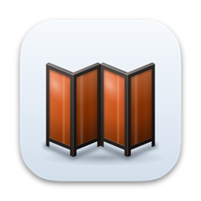
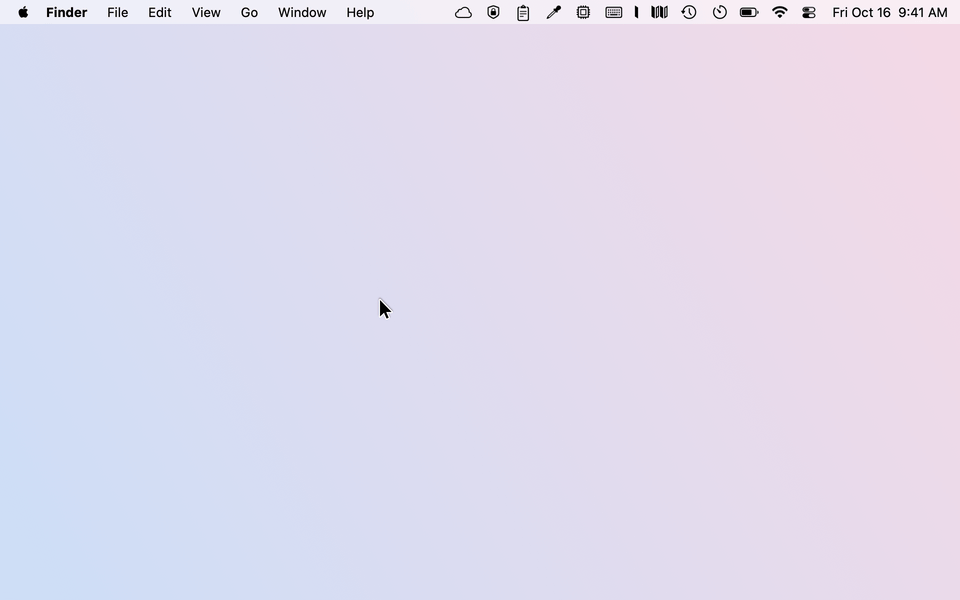

# Paravent

**Tuck away the menu bar icons you don’t need, and keep them a hover away.**

[Website](https://hamzabasaran.com/paravent) · [Download Paravent.dmg](https://github.com/mehambas/paravent/releases/latest/download/Paravent.dmg) · [Changelog](CHANGELOG.md)

A paravent is a folding screen, and the menu bar icons you don’t need slip behind it. Paravent puts a divider in your menu bar: the icons left of it are tucked away, the rest stay where they are. Point at Paravent’s icon and the tucked-away icons appear in a small panel; click one and its menu opens right where it belongs.

<picture>
  <source media="(prefers-color-scheme: dark)" srcset="docs/images/demo-dark.gif">
  
</picture>

## Features

- **A tidy menu bar.** Icons left of the divider are tucked away; the clock, Control Center and the icons you want stay in view.
- **Three choices per icon:** **Shown** in the menu bar, **In Panel** behind the divider and one hover away, or **Hidden** entirely.
- **The panel.** Point at Paravent’s icon to see the icons you tucked away. Click one and Paravent brings it back just long enough for its menu, then tucks it away again.
- **Apply arranges the bar for you.** Paravent ⌘-drags each icon to its side of the divider, so you don’t have to.
- **Private.** No telemetry, and nothing about you or your Mac leaves it. The only network request is a daily check for a new version.
- Native SwiftUI and AppKit, light and dark, English and Turkish. Apple silicon and Intel, macOS 15 or later.

## Install

1. Download [Paravent.dmg](https://github.com/mehambas/paravent/releases/latest/download/Paravent.dmg) from the [latest release](https://github.com/mehambas/paravent/releases/latest).
2. Open it and drag **Paravent** to **Applications**.
3. Eject the disk image and open Paravent from **Applications**, not from the disk image. Paravent is not notarized by Apple (that needs a paid developer account), so macOS blocks the first launch:
   - macOS says it could not verify Paravent. Click **Done**.
   - Open **System Settings › Privacy & Security**, scroll down to *“Paravent” was blocked*, click **Open Anyway** and confirm.

   This is needed once per download.
4. Paravent asks for two permissions. In **System Settings › Privacy & Security**, turn Paravent on under **Accessibility** and under **Screen Recording**, and choose **Quit & Reopen** when macOS offers it. Paravent needs Accessibility to read, press and move menu bar icons, and Screen Recording to show pictures of them in its panel.
5. Paravent lives in the menu bar, next to the system icons: the folding screen is Paravent, the single leaf to its left is the divider.

To start Paravent when you log in, turn on **Settings › General › Open at login**.

### Updates

Paravent checks for a new version once a day. When one is out, the panel shows **Update to** and the version number, and so does the menu you get by right-clicking Paravent’s icon. **Settings › General** shows the release notes and **Download and Install**. That downloads the new disk image, verifies it and opens it, then Paravent quits: drag **Paravent** to **Applications** and replace the old version. **Check for Updates…** in the right-click menu checks right away.

## Usage

**Choose what goes where.** Right-click Paravent’s icon and choose **Settings…** (or open Paravent again from Applications). **Menu Bar** lists every icon in your menu bar. Set each one to **Shown**, **In Panel** or **Hidden**, then click **Apply**. Paravent shows the divider and ⌘-drags the icons to their side of it; the pointer moves on its own for a few seconds, so leave the mouse alone until it is done. Then the divider closes and the bar is tidy.

You can also arrange icons yourself: hold ⌘ and drag them left or right of the divider, as you would move any menu bar icon.

| In the menu bar | Action |
| --- | --- |
| Point at Paravent’s icon | Open the panel with the icons set to **In Panel** |
| Click Paravent’s icon | Keep the panel open until you click elsewhere |
| Click an icon in the panel | Open that app’s menu in the menu bar; the icons tuck away again when it closes |
| Right-click Paravent’s icon | **Settings…**, **Show Hidden Icons** / **Hide Icons Again**, **Check for Updates…**, **Quit Paravent** |
| ⌘-drag an icon across the divider | Tuck it away or bring it back |

**Show Hidden Icons** opens the divider until you choose **Hide Icons Again**. The clock and Control Center can’t be moved or hidden.

**Settings** has two tabs:

- **Menu Bar**: every icon with its choice, and **Apply**.
- **General**: open at login and updates.

## Privacy

- Paravent has no telemetry and sends nothing about you or your Mac anywhere. Its only network request asks GitHub for the latest version number, once a day; turn it off with **Settings › General › Check for updates automatically**. An update is downloaded only when you click **Download and Install**.
- Screen Recording is used only for pictures of the menu bar icons, never for the rest of the screen. Accessibility is used only for the menu bar.
- Your choices, the icon pictures and a short diagnostic log with the names of the icons Paravent moved are in `~/Library/Application Support/Paravent`. The positions of Paravent’s own items and the update settings are in `~/Library/Preferences/com.hamzabasaran.paravent.plist`.

## Uninstall

1. If **Open at login** is on, turn it off in **Settings › General**.
2. Right-click Paravent’s icon, choose **Quit Paravent** and move `/Applications/Paravent.app` to the Trash. The tucked-away icons come back on their own.
3. Remove its settings and permissions:

   ```sh
   rm -rf ~/Library/Application\ Support/Paravent
   defaults delete com.hamzabasaran.paravent
   tccutil reset All com.hamzabasaran.paravent
   ```

## Build from source

You need macOS 15 or later and Xcode 16 or the Swift 6 command line tools. There are no other dependencies.

```sh
git clone https://github.com/mehambas/paravent.git
cd paravent
swift test --disable-sandbox
bash scripts/build.sh
open dist/Paravent.app
```

`scripts/build.sh` builds a universal app. It is signed ad hoc, so macOS asks for Accessibility and Screen Recording again after each rebuild; see [How Paravent works](docs/how-it-works.md#development) for a stable signature, the visual check and the release script.

## Support

Paravent is free and open source. If it keeps your menu bar tidy, you can [buy me a coffee on Ko-fi](https://ko-fi.com/mehambas91) ☕

Found a bug or have an idea? [Open an issue](https://github.com/mehambas/paravent/issues).

## License

[MIT](LICENSE)
